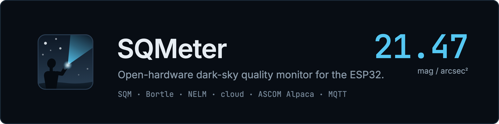
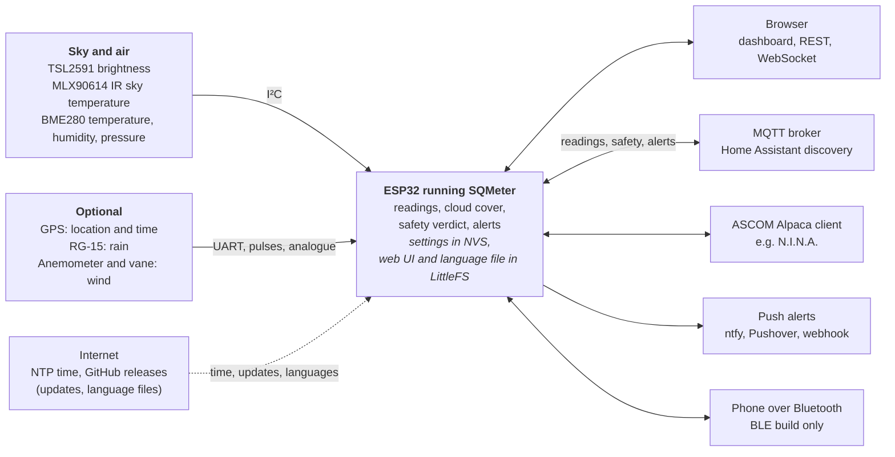

# SQMeter

**SQMeter is an open-source (MIT) sky quality meter and observatory safety monitor built on the ESP32.** The device is a native **ASCOM Alpaca SafetyMonitor and ObservingConditions** device: N.I.N.A. and other imaging apps find it on the network with no Windows driver or bridge, and your own rules for rain, wind, cloud, sky brightness, humidity and dew point decide when it's safe to image. Both devices pass ASCOM ConformU on every change.

A TSL2591 light sensor gives sky brightness in mag/arcsec² (SQM), Bortle class and naked-eye limiting magnitude (NELM), an MLX90614 infrared sensor estimates cloud cover from sky temperature, and a BME280 adds temperature, humidity and pressure. A Hydreon RG-15 rain gauge, anemometer and wind vane, and GPS are optional. The device serves its own web dashboard in 14 languages, sends alerts by ntfy, Pushover, webhook, MQTT or a Bluetooth alarm on your phone, publishes to MQTT with Home Assistant discovery, and has a REST API (OpenAPI 3.1) and live WebSocket updates. It's for backyard and remote observatories, imaging rigs and dark-sky monitoring. SQMeter is in public beta (v0.3.x).

## Links

- **Docs:** https://sqmeter.dev/
- **Demo:** https://demo.sqmeter.dev/
- **Releases:** https://github.com/DeanJ87/SQMeter/releases

## How it fits together

<!-- diagram: DIA-01
sources: src/main.cpp#setup include/sensors/ include/WebServer.h include/MQTTClient.h include/AlertDispatcher.h include/BleService.h include/OtaUpdater.h include/TimeManager.h
blocking: false
fingerprint: 7922de94bffa9319
-->

*Figure: What SQMeter connects to: sensors in, the ESP32 in the middle, and everything it talks to.*

Diagram in words

- **Sensors** into the ESP32: TSL2591 sky brightness, MLX90614 IR sky temperature and BME280 temperature, humidity and pressure on I²C; optional GPS and RG-15 rain gauge on serial (UART); optional anemometer (pulses) and wind vane (analogue).
- **The ESP32** works out the readings, cloud cover, the safety verdict and alerts, with settings in NVS and the web UI (and the chosen language's file) in LittleFS.
- **Outputs**: browsers (dashboard, REST, WebSocket); an MQTT broker (readings, safety, alerts, Home Assistant discovery, alerts pause/resume); ASCOM Alpaca clients such as N.I.N.A.; push alerts (ntfy, Pushover, webhook, MQTT); a phone over Bluetooth on the BLE build.
- **From the internet**: NTP time, and GitHub releases for updates and language files.

## Highlights

- TSL2591 light sensor — SQM, NELM, Bortle 1–9
- BME280 — temperature, humidity, pressure
- MLX90614 — IR cloud temperature and cloud cover estimate
- GPS support (optional) — location and precise time
- RG-15 rain sensor and anemometer / wind vane support (optional)
- Native ASCOM Alpaca SafetyMonitor + ObservingConditions (N.I.N.A.-compatible, no bridge), tested with ConformU on every PR
- Safety rules for rain, wind, cloud, SQM, humidity and dew point, with the reasons shown and a safe delay
- Alerts via Pushover, ntfy, webhook, MQTT or a paired phone over Bluetooth — per-event levels and sounds, your own wording, only when it's dark, sent any time or only while an imaging app is connected, a pause switch for Home Assistant, and an alert when the imaging app goes quiet.
- Real-time dashboard with reorderable cards and a Sun & Moon night chart
- REST API and MQTT publishing (including a 1/0 safe flag for logging)
- OTA firmware updates from the browser, or self-updated directly from GitHub Releases
- Captive portal WiFi setup on first boot

## How SQMeter compares

There are several good open-source sky quality meter projects. In brief:

| Project | What it is | Good at |
|---|---|---|
| [mySQM+](https://sourceforge.net/projects/mysqmproesp32/) by Robert Brown | ESP32 sky quality meter and weather station, successor to the Arduino Nano + TSL237 [mySQM](https://sourceforge.net/projects/arduinomysqmskyqualitymeter/) | A long-running, feature-rich DIY build with its own web server, MQTT, a Windows application, Windows ASCOM ObservingConditions and SafetyMonitor drivers, and published PCB files |
| [SimpleSQM](https://github.com/marcocipriani01/SimpleSQM) | Arduino Nano + TSL237 with an ASCOM ObservingConditions driver | The simplest possible build: one sensor, three wires, the same sensor as the Unihedron SQM |
| [SQM_TSL2591](https://github.com/gshau/SQM_TSL2591) by gshau | Arduino library for SQM readings from a TSL2591 | Adaptive gain and exposure, noise estimates, and SQM-LE / SQM-LU emulator examples for software that expects a Unihedron meter |
| [PySQM](https://github.com/mireianievas/PySQM) | Python client for Unihedron SQM-LE and SQM-LU meters | Logging and plotting readings in the IDA NSBM community-standard format; it reads meters, it isn't one |

Where SQMeter differs: the ASCOM Alpaca devices run **on the ESP32 itself**, so any Alpaca client on any OS connects directly (no Windows driver), and they're tested with ASCOM ConformU in CI. On top of the sky readings it is a safety monitor with your own rules and the reasons shown, sends alerts itself (ntfy, Pushover, webhook, MQTT, Bluetooth phone alarm), announces itself to Home Assistant over MQTT, and documents its REST API with OpenAPI. It does **not** speak the Unihedron SQM-LE/LU protocol, and a bare TSL2591 sees a much wider patch of sky than a commercial SQM, so match one with a lens or baffle and the calibration offset ([why](https://sqmeter.dev/reference/sky-quality/)).

## Quick Start

See [Flashing Your Device](https://sqmeter.dev/getting-started/flashing/) to get started with a new ESP32.

## Current Security Model

SQMeter is intended for a trusted local network. Optional HTTP Basic Auth protects settings changes, restarts and updates, but it's off by default, there is no TLS, and readings, saved configuration (passwords masked) and ASCOM Alpaca are always readable on the LAN. Do not port-forward the device or place it on guest WiFi. See [Security](https://sqmeter.dev/user-guide/security/).
