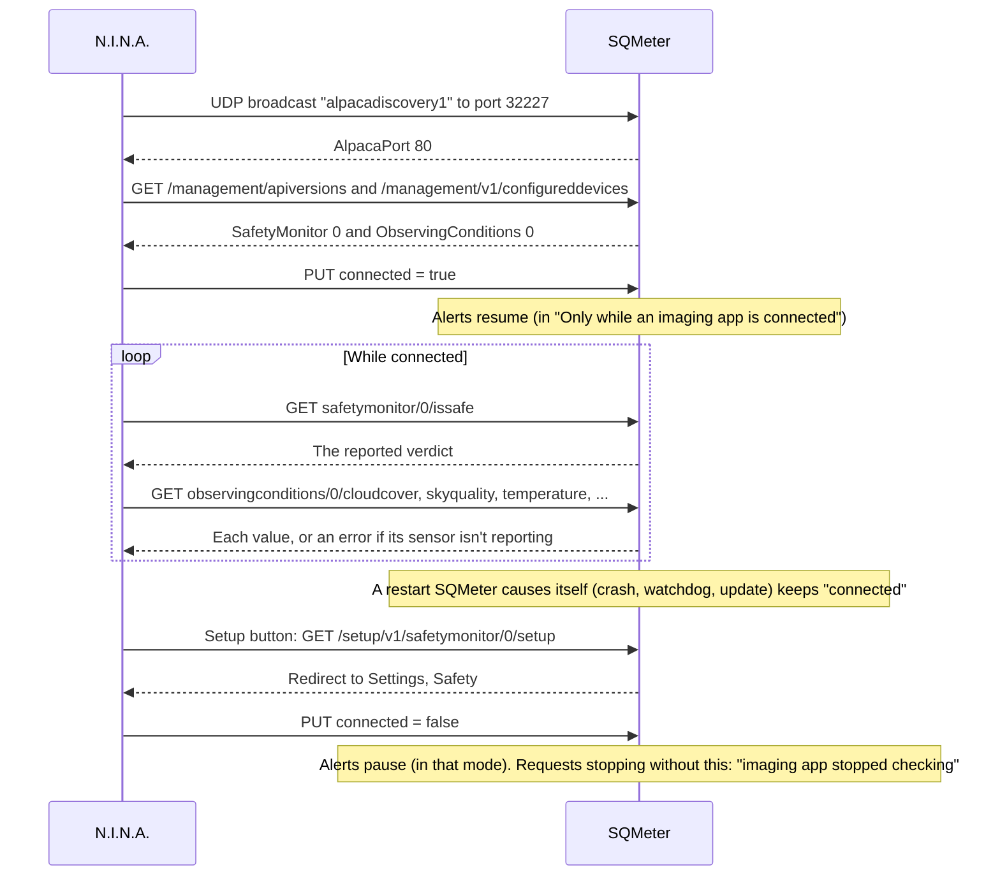

```mermaid
flowchart TB
    accTitle: How the safety verdict is decided
    accDescr: Every second all enabled rules are checked and each failing rule adds a reason. Force unsafe, safety holds, rain, wind and battery are always checked, then data freshness and sensor health; the threshold rules only run on fresh data. Any reason makes the raw verdict unsafe, which then passes through the safe and unsafe delays.
    START(["Every second"]) --> ALWAYS
    ALWAYS["<b>Always checked</b>, even on stale data<br/>Force unsafe on, the manual hold: <i>Manual override forces unsafe</i><br/>Each safety hold another system set: <i>its reason</i><br/>Raining, or within the rain clear delay, unless Rain needs cloud classes it as dew: <i>Rain ...</i><br/>Rain sensor offline, stale or lens fault: <i>Rain sensor offline...</i><br/>Wind limit set but anemometer off or silent: <i>Wind limit set but...</i><br/>Wind or gust at or over its limit: <i>Wind ... / Gust ...</i><br/>Battery rule on but no gauge data: <i>Battery data missing</i><br/>Battery below its limit: <i>Battery ...</i><br/>About to sleep at the shutdown level: <i>Shutting down: battery ...</i>"]
    ALWAYS --> FRESHNESS["<b>Data freshness</b><br/>No light or IR read since boot: <i>No successful sensor data yet</i><br/>Light or IR sensor's last successful read older than the stale limit, 30 s: <i>Sensor data is stale</i>"]
    FRESHNESS --> HEALTH["<b>Sensor health</b><br/>Light sensor or IR sky sensor not OK: <i>Sensor fault: ...</i><br/>with two sky sensors only the authoritative one, SQM or SQM-L"]
    HEALTH --> FRESH{"Fresh data?"}
    FRESH -->|yes| THRESHOLDS["<b>Thresholds</b><br/>Cloud cover at or over the limit, unless the IR sky sensor is faulted<br/>SQM or SQM-L below the minimum, unless that sensor is faulted<br/>Humidity or dew rule on but no humidity reading: <i>Sensor fault: environment sensor</i><br/>otherwise humidity over its maximum, or air minus dew point below the margin"]
    FRESH -->|"no: skip, already unsafe"| ANY
    THRESHOLDS --> ANY{"Any reasons?"}
    ANY -->|none| RAWSAFE["Raw verdict: safe"]
    ANY -->|one or more| RAWUNSAFE["Raw verdict: unsafe, with every reason"]
    RAWSAFE --> DELAY["Safe and unsafe delays"]
    RAWUNSAFE --> DELAY
    DELAY --> REPORTED["Reported verdict<br/>dashboard, /api/safety, /api/safe,<br/>MQTT safe, Alpaca IsSafe"]
    REPORTED --> ALPACA{"Alpaca switched on?"}
    ALPACA -->|yes| ISSAFE["IsSafe = the reported verdict"]
    ALPACA -->|no| NOTCONNECTED["IsSafe false, with a NotConnected error"]
```

```mermaid
stateDiagram-v2
    accTitle: The safe and unsafe delays
    accDescr: The device starts unsafe. When the raw verdict turns safe it waits for the safe delay, reporting unsafe meanwhile; any failing rule restarts the wait. From safe, a failing rule waits for the unsafe delay, reporting safe meanwhile; passing again cancels it. Rain, force unsafe, a safety hold and a battery shutdown are reported unsafe at once.
    state "Reported unsafe" as Unsafe
    state "Waiting: raw safe, reported unsafe" as Waiting
    state "Reported safe" as Safe
    state "Holding: raw unsafe, reported safe" as Holding
    [*] --> Unsafe: device starts
    Unsafe --> Waiting: every rule passes
    Waiting --> Unsafe: a rule fails, the countdown resets
    Waiting --> Safe: safe for the whole safe delay
    Safe --> Holding: a rule fails, unsafe delay set
    Holding --> Safe: every rule passes again
    Holding --> Unsafe: unsafe for the whole unsafe delay
    Safe --> Unsafe: a rule fails, no unsafe delay, or rain, force unsafe, a hold, shutdown
    Holding --> Unsafe: rain, force unsafe, a hold or shutdown
```

# ASCOM Alpaca

SQMeter can act as an ASCOM Alpaca **SafetyMonitor** and **ObservingConditions** device directly - no separate bridge/service needed. N.I.N.A. and other ASCOM Alpaca clients connect straight to the device's IP address.

!!! note "Replaces the standalone bridge"
    Earlier setups used a separate `SQMeter-ASCOM-Alpaca` Windows service/`.exe` that polled the device's REST API and re-served it as Alpaca. That bridge still works, but is no longer necessary - the device now speaks Alpaca natively. If you're migrating from it, disconnect N.I.N.A. from the bridge's devices first, then follow this guide to connect directly to the device instead.

---

## Enabling Alpaca support

1. Open the web UI and go to **Settings → Safety**
2. In the **ASCOM Alpaca** card, turn on **Serve Alpaca devices**
3. Set your safety rules (see [Safety rules](#safety-rules) below) and **Save**
4. When asked, restart the device: the UDP discovery listener that N.I.N.A. uses to find the device only starts at boot

Alpaca support is disabled by default. With it off, every Alpaca endpoint still responds (so tooling doesn't 404) but reports `connected: false` and a `NotConnected` error - it just isn't discoverable or usable until enabled.

!!! note "Upgrading from an earlier firmware"
    Device `UniqueID`s now include the board's MAC address (e.g. `sqmeter-a1b2c3d4e5f6-safetymonitor-0`) so two SQMeters on the same network never collide. If N.I.N.A. was already connected to a previous firmware, re-select both devices once after upgrading.

---

## Connecting from N.I.N.A.

<!-- diagram: DIA-10
sources: lib/AlpacaLogic/src/AlpacaDiscovery.cpp lib/AlpacaLogic/src/AlpacaRouter.cpp src/WebServerAlpaca.cpp#WebServer::setupAlpacaRoutes
blocking: false
fingerprint: 3240e9c6c60fc2ab
-->
<figure class="diagram" markdown>



<figcaption>N.I.N.A. and SQMeter over Alpaca: discovery, connecting, polling and the Setup button.</figcaption>
</figure>

??? info "Diagram in words"

    1. N.I.N.A. broadcasts `alpacadiscovery1` on UDP port 32227. SQMeter answers `{"AlpacaPort": 80}` - only when **Serve Alpaca devices** was on when it started, since the listener starts at boot.
    2. N.I.N.A. asks the management API (`/management/apiversions`, `/management/v1/configureddevices`) and gets **SafetyMonitor 0** and **ObservingConditions 0**.
    3. Connecting sends `PUT .../connected` with `Connected=true`.
    4. While connected, N.I.N.A. polls `safetymonitor/0/issafe` (the reported verdict, after the safe and unsafe delays) and the ObservingConditions properties; a property whose sensor isn't reporting returns an error instead of a value.
    5. If SQMeter restarts on its own (a crash, the watchdog, an update) while N.I.N.A. is connected, it still reports `Connected=true` afterwards, so N.I.N.A. carries on. After a power cut it starts with nothing connected. See [N.I.N.A. loses the Safety Monitor](../reference/troubleshooting.md#nina-loses-the-safety-monitor).
    6. The Setup button opens `/setup/v1/<device>/0/setup`, which redirects to **Settings → Safety** in the web UI.
    7. Disconnecting sends `Connected=false`.
    8. SQMeter notes every request: with **When to send** set to *Only while an imaging app is connected*, a connect resumes alerts and the last disconnect pauses them; if requests stop without a disconnect, the "imaging app stopped checking" alert fires (see [Alerts](alerts.md#the-imaging-app)).
    9. With Alpaca switched off, every endpoint still answers but reports not connected, and `IsSafe` returns false with a NotConnected error.

### What clients show

The management API's description is how N.I.N.A. and other clients name the server:

| Field | Value |
|---|---|
| `ServerName` | The device's name (**Settings → Device → Name**) |
| `Manufacturer` | `SQMeter` |
| `ManufacturerVersion` | The firmware version |
| `Location` | Where the device is: the location in use as `lat, lon` (a GPS fix, otherwise **Settings → Time & Location → Location**), e.g. `51.4779, -0.0015`; empty when no location is set |

### SafetyMonitor

1. Equipment → **Safety Monitor** → select **ASCOM Alpaca**
2. Click **Refresh** - N.I.N.A. broadcasts a UDP discovery request on port `32227`; SQMeter responds and N.I.N.A. lists **SQMeter SafetyMonitor**
3. Select it and click **Connect**

### ObservingConditions

1. Equipment → **Weather** (Observing Conditions) → select **ASCOM Alpaca**
2. Click **Refresh**, select **SQMeter ObservingConditions**, **Connect**

Both devices are served from the same device/port - connecting one doesn't require or block the other.

### Alpaca page

The web UI's **Alpaca** tab lists every advertised device with its device type, number, `UniqueID`, setup page, API base URL and live `DeviceState` (refreshed every 5 s), plus the host/port to use when adding the device manually. Use it to confirm what N.I.N.A. should see without leaving the browser.

Under **Imaging app** it shows, per device, whether an imaging app is checking it - "Connected, last checked 3 s ago", "Gone quiet, last checked 4 min ago" or "Waiting for an imaging app". The page's own live-state requests (tagged `source=ui`) don't count. Alerts can tell you when an imaging app stops checking, and can be sent only while one is connected - see [Alerts → When to send](alerts.md#when-to-send).

### Setup button

The **Setup** (cog) button next to either device in N.I.N.A. opens `http://<device>/setup/v1/<devicetype>/0/setup`, which redirects to **Settings → Safety** (the ASCOM Alpaca card and safety rules) in the web UI. Rules changed there apply as soon as you save.

### If discovery doesn't find the device

- Confirm **Serve Alpaca devices** is on under **Settings → Safety → ASCOM Alpaca** and the device has been restarted since
- Discovery is a UDP broadcast (and, with [IPv6](ipv6.md) on, the IPv6 group `ff12::a1:2345`) - it won't cross VLANs/subnets or most VPNs; N.I.N.A. and the device need to be on the same local network segment
- As a fallback, most Alpaca clients (including N.I.N.A.) let you add a device manually by IP:port instead of relying on discovery - use the device's IP and port `80`

---

## Safety rules

The safety verdict is re-evaluated every second from the current sensor readings against the rules in **Settings → Safety → Safety rules**. It is shown on the Dashboard's **Safety Monitor** card, on the **Alpaca** page, from `GET /api/safety`, and served to Alpaca clients as `SafetyMonitor.IsSafe`. Any of the following makes it unsafe:

1. **Manual override and safety holds** - the **Force unsafe** toggle is on (the built-in hold `manual`: "Manual override forces unsafe"), or another system holds it unsafe with a [safety hold](#safety-holds) (the hold's own reason, e.g. "Smoke: neighbour's fire, PM2.5 85 µg/m³")
2. **Rain** - the RG-15 reports rain, *or* it rained within the rain sensor's "rain clear delay" (default 15 min; see [the rain latch](../hardware/rg15.md#the-rain-latch)). Enabled by default whenever the rain sensor is enabled. The reason gives the intensity: "Rain 0.40 mm/h" ("Rain detected" while the sensor reports no rate). With [Rain needs cloud](#rain-needs-cloud) on, rain under a healthy clear sky counts as dew instead
3. **Rain sensor offline/faulty** - the rain sensor is enabled but not responding, its data is stale, or it reports a lens fault (fail safe; enabled by default)
4. **Wind / gust** - the 2-minute mean wind speed or the 10-minute peak gust is at or above its limit (both disabled by default). If a wind limit is enabled but the [anemometer](../hardware/wind.md) is disabled or not reporting, that's unsafe too
5. **No data yet** - the device hasn't completed a sensor read since boot
6. **Stale data** - the last successful read is older than the stale-data threshold (default 30s; while the battery is [saving power](battery.md#power-saving-and-deep-sleep) the limit grows by the slower read interval, and the reason shows the limit in use)
7. **Sensor fault** - the light sensor (TSL2591) or IR sky sensor (MLX90614) is reporting a non-OK status. With two sky sensors only the authoritative one counts, and the reason names it: "Sensor fault: SQM sensor" or "Sensor fault: SQM-L sensor" ([no fallback](../reference/sky-quality.md#two-sky-sensors-sqm-and-sqm-l))
8. **Cloud cover** - at or above the configured threshold (default 90%, if enabled)
9. **Sky brightness (SQM)** - the authoritative sky sensor below the configured minimum (disabled by default): "SQM 18.21 < 19.50", or "SQM-L 18.21 < 19.50" when the SQM-L counts
10. **Humidity** - above the configured maximum (disabled by default)
11. **Temperature-dewpoint margin** - below the configured minimum (disabled by default)
12. **Sensor fault: environment sensor** - the humidity or dew-point rule is enabled but the environment sensor (BME280) isn't reporting, so it can't be evaluated
13. **Battery** - the battery charge is below the limit (default 10%, disabled by default): "Battery 8% < 10%". If the rule is on but there is no fuel gauge, or its data is stale or still estimating, that's unsafe too: "Battery data missing". A charging pack below the limit stays unsafe. See [Battery](battery.md#the-safety-rule)
14. **Shutting down** - the battery has reached its shutdown level and the device is about to sleep, whether or not the battery rule is on: "Shutting down: battery 4% <= 5%"

Holds, rain, wind and battery rules (1-4, 13-14) are checked even when the other sensors' data is stale or missing - nothing should hide the fact that it's raining, blowing a gale or about to switch off. Rules 8-12 only apply to fresh data. The one case where another sensor changes the rain outcome is [Rain needs cloud](#rain-needs-cloud), which you switch on yourself, and even then only a fresh, healthy clear-sky reading can do it.

Each threshold has its own enable/disable toggle - a disabled threshold never contributes to the verdict.

<!-- diagram: DIA-02
sources: lib/AlpacaLogic/src/SafetyEvaluator.cpp lib/DeviceCore/src/DeviceCore.cpp#safetyInputs lib/DeviceCore/src/DeviceSafety.cpp#safetyThresholds lib/AlpacaLogic/include/AlpacaRouter.h
blocking: true
fingerprint: 0e0ce88bb6b535d5
-->
<figure class="diagram" markdown>



<figcaption>How the safety verdict is decided. Each rule only counts when it's switched on; every failing rule adds its reason.</figcaption>
</figure>

??? info "Diagram in words"

    Every second the device checks all enabled rules and collects a reason for each one that fails:

    1. **Always checked**, even when the other data is stale or missing:
        - Force unsafe is on (the built-in hold `manual`): "Manual override forces unsafe".
        - Each [safety hold](#safety-holds) another system set: its own reason, e.g. "Smoke: neighbour's fire".
        - The rain sensor reports rain, or rain within the rain clear delay: "Rain 0.40 mm/h", or "Rain detected" without a rate. With [Rain needs cloud](#rain-needs-cloud) on, rain under a fresh, healthy clear-sky reading is dew suspected instead, not a reason; otherwise the reason says why the rain counts ("... with cloud 35% >= 10%", "... with no cloud reading", "... held until dry").
        - The rain sensor is enabled but offline, stale or reporting a lens fault: "Rain sensor offline, stale or reporting a lens fault".
        - A wind limit is set but the anemometer is disabled or not reporting: "Wind limit set but the anemometer is disabled or not reporting". Otherwise wind or gust at or over its limit: "Wind ..." / "Gust ...".
        - The battery rule is on but there's no fuel gauge, or its data is stale or estimating: "Battery data missing". Otherwise the charge below the limit: "Battery ...".
        - The device is about to sleep at the battery's shutdown level (rule on or not): "Shutting down: battery ...".
    2. **Data freshness**: no successful TSL2591 or MLX90614 read since boot gives "No successful sensor data yet". If either sensor is still answering but its last successful read is older than the stale limit (default 30 s), that gives "Sensor data is stale" - a sensor that keeps reporting OK without fresh readings counts as stale. A sensor that has stopped answering is reported under sensor health instead.
    3. **Sensor health**: the light sensor or IR sky sensor not OK gives "Sensor fault: ..." naming which ("Sensor fault: IR sky sensor"). With two sky sensors the light sensor is the authoritative one, named "SQM sensor" or "SQM-L sensor"; the other one never changes the verdict.
    4. **Only with fresh data**, the threshold rules:
        - cloud cover at or over its limit (skipped if the IR sky sensor is faulted);
        - SQM below its minimum (skipped if the light sensor is faulted);
        - if the humidity or dew-point rule is on but there's no humidity reading, "Sensor fault: environment sensor"; otherwise humidity above its maximum, or air temperature minus dew point below the margin.
    5. No reasons: the raw verdict is safe. Any reason: unsafe, with all the reasons.
    6. The raw verdict passes through the [safe delay](#safe-delay) and [unsafe delay](#unsafe-delay), and the result is what the dashboard, `/api/safety`, `/api/safe`, MQTT `<base>/safe` and Alpaca `IsSafe` report.
    7. With Alpaca switched off, `IsSafe` returns false with a NotConnected error instead (see [Connecting from N.I.N.A.](#connecting-from-nina)).

### Rain needs cloud

An optical rain sensor such as the RG-15 can dew or frost over on a clear, cold night and report light rain from a starry sky. **Settings → Safety → Safety rules → Rain needs cloud** (off by default) stops that parking the telescope: rain then only makes the observatory unsafe when the IR sky sensor sees cloud, or when the sky sensor can't be trusted.

- **Cloud to confirm rain** (default 10%, 1-100%): cloud cover at or above it confirms the rain, and the reason says so: "Rain 0.40 mm/h with cloud 35% >= 10%". It is separate from the cloud cover rule's limit, and works whether that rule is on or off.
- Rain under a clear sky is **dew suspected**: not an unsafe reason. The dashboard's **Rain Sensor** card shows "Rain under a clear sky: dew suspected", `GET /api/safety` and MQTT `<base>/safety` carry `dewSuspected` with the rain intensity and cloud cover, Home Assistant gets a **Dew suspected** binary sensor, and you can choose an [alert](alerts.md) for it, so you know to clean or heat the lens.
- **Fail-safe**: rain is always trusted unless the IR sky sensor is detected, OK, fresh and its cloud cover can be worked out. A missing, faulted or stale sky sensor never hides rain: "Rain 0.40 mm/h with no cloud reading".
- **Once trusted, rain stays trusted** until the rain sensor reports dry and its rain clear delay has ended, so a gap in the cloud mid-shower doesn't open the roof: "Rain 0.40 mm/h, held until dry".
- The rain sensor fault rule, safety holds and Force unsafe are not affected. With the rain rule itself off, dew suspected is still reported.
- The setting is disabled while the rain sensor is off or the IR sky sensor isn't detected (rain would always count).

Leave it off if you don't trust your sky sensor's cloud reading. A restart forgets that rain was already trusted, so for the first evaluation after a restart a clear-sky reading can class ongoing rain as dew.

### Reasons

Every failing rule is listed as a reason with the measured value and the limit, e.g. `SQM 18.70 < 19.50` or `Cloud 96% >= 90%`. The reasons are shown on the Dashboard's **Safety Monitor** card, returned by `GET /api/safety`, published to MQTT `<base>/safety`, and used in alert messages (`{reasons}`).

!!! note "The same in every language"
    Alpaca answers never change with the UI language: `IsSafe` and the ObservingConditions values are numbers with `.` decimals in fixed units, whatever language the web interface uses. The reasons are English text for people to read, written with a `.` decimal point; scripts should use `reasonFlags` from `/api/safety` instead.

The Safety Monitor card's **History** lists recent safe/unsafe changes, restarts and the safety alerts that were sent - kept across restarts (not power cuts) - which answers "it went unsafe and I got no alert: why?".

### Safety holds

A **safety hold** lets another system keep the SafetyMonitor unsafe for something SQMeter can't measure - smoke from a neighbour's fire on Home Assistant's PM2.5 sensor, a roof controller whose roof didn't open fully - and clear **that event only** later. Each hold has an id (`smoke`, `roof`), a reason people read and who set it:

- While any hold exists the verdict is unsafe, at once (no [unsafe delay](#unsafe-delay)). Several can be set at once; up to 8.
- Clearing a hold never forces safe: the other rules still decide. Clear `smoke` while it's cloudy and it stays unsafe for cloud; the [safe delay](#safe-delay) applies as usual.
- Clearing an id that has no hold (already cleared, never set) changes nothing.
- Holds survive restarts. One set with `expiresMin` lifts by itself at that time, also after a restart (until the clock is set after a restart, it waits the full time from the restart - never less).
- **Force unsafe** is the built-in hold `manual`: switching it on sets it, off clears it, and clearing `manual` from another system switches the toggle off.

The Safety Monitor card lists each hold under the other reasons - its reason, then `Hold "smoke" · Home Assistant · since 21:14` (and `· lifts 01:14` with an expiry) and **Clear**. The history shows "Hold cleared: Smoke (still unsafe: cloud)". The unsafe alert and Alpaca clients see the hold's reason like any other.

Set and clear holds with [`POST /api/safety/hold` and `DELETE /api/safety/hold/<id>`](../api/rest.md#safety-holds), or MQTT [`<base>/safety/hold/set`](mqtt.md#safety-holds). With password protection on, HTTP calls need the device's username and password.

**Home Assistant example** - a PM2.5 sensor holds the observatory unsafe while the air is smoky (`configuration.yaml`):

```yaml
rest_command:
  sqmeter_smoke_on:
    url: "http://sqmeter.local/api/safety/hold"
    method: POST
    content_type: "application/json"
    payload: '{"id": "smoke", "reason": "Smoke: PM2.5 {{ states(''sensor.pm25'') }} µg/m³", "source": "Home Assistant", "expiresMin": 720}'
  sqmeter_smoke_off:
    url: "http://sqmeter.local/api/safety/hold/smoke"
    method: DELETE

automation:
  - alias: "Smoke holds the observatory unsafe"
    triggers:
      - trigger: numeric_state
        entity_id: sensor.pm25
        above: 35
        for: "00:05:00"
    actions:
      - action: rest_command.sqmeter_smoke_on
  - alias: "Smoke gone: clear the hold"
    triggers:
      - trigger: numeric_state
        entity_id: sensor.pm25
        below: 15
        for: "00:30:00"
    actions:
      - action: rest_command.sqmeter_smoke_off
```

Add `username:` and `password:` to each `rest_command` when protection is on. Over MQTT instead (no password needed on the device; the broker's own rules apply):

```yaml
      - action: mqtt.publish
        data:
          topic: "sqmeter/safety/hold/set"
          payload: '{"id": "smoke", "reason": "Smoke: PM2.5 high", "source": "Home Assistant"}'
      # and to clear it:
      - action: mqtt.publish
        data:
          topic: "sqmeter/safety/hold/set"
          payload: '{"id": "smoke", "clear": true}'
```

The `expiresMin` of 720 (12 hours) is a backstop: if Home Assistant goes down with the hold set, it lifts by itself.

### Safe delay

**Safe delay** (seconds, default `0`) holds a "safe" verdict back until conditions have been continuously safe for that long, so a brief gap in the clouds doesn't reopen the roof. The delay also applies after a reboot. While the delay is running, the Safety Monitor card shows "Safe in Ns".

### Unsafe delay

**Unsafe delay** (seconds, default `0`, at most 600) is the other direction: while the device reports safe, a failing rule must keep failing for that long before it reports unsafe, so one odd cloud or humidity reading doesn't park the scope. If every rule passes again before the delay runs out, the device stays safe and the countdown starts from zero next time. While it runs, the Safety Monitor card shows "Unsafe in Ns" with the reasons, and `/api/safety` shows `safe: true`, `rawSafe: false` and `secondsUntilUnsafe`. Alerts, MQTT, Bluetooth and Alpaca `IsSafe` follow the reported verdict, so nothing is announced until the delay runs out.

Three reasons are never delayed:

- **Rain** (only when the rain rule is on), the moment the rain sensor reports it.
- **Force unsafe** and **safety holds**, a deliberate choice. Clearing a hold is not: the safe delay still applies.
- **Shutting down**: the battery is about to sleep.

With `0` every failing rule is reported at once. 30-60 s is a sensible value: long enough to ride out a single odd reading, short enough to close before real cloud matters. It adds to the stale limit: with a 30 s stale limit and a 60 s unsafe delay, sensors that stop updating are reported unsafe after about 90 s. A reboot always starts unsafe and waits for the safe delay; the unsafe delay only holds a verdict that is already safe.

<!-- diagram: DIA-03
sources: lib/AlpacaLogic/src/SafetyEvaluator.cpp#SafeDelayFilter::update lib/DeviceCore/src/DeviceSafety.cpp#updateSafety
blocking: true
fingerprint: a200bbdcd94d9f0b
-->
<figure class="diagram" markdown>



<figcaption>The safe and unsafe delays. The raw verdict and the reported verdict differ only while waiting or holding; with both delays at 0 there's neither.</figcaption>
</figure>

??? info "Diagram in words"

    - The device starts reporting **unsafe** (it has no data yet, and the countdown only starts once the rules pass).
    - When every rule passes, the raw verdict is safe and the safe-delay countdown starts. The device still reports **unsafe**; `/api/safety` shows `rawSafe: true` and `secondsUntilSafe`, and the dashboard shows "Safe in Ns".
    - If any rule fails during the wait, the device stays unsafe and the countdown starts again from zero the next time every rule passes.
    - After the raw verdict has been safe for the whole safe delay, the device reports **safe**. With a delay of 0 this happens immediately.
    - From safe, a failing rule starts the unsafe-delay countdown. The device still reports **safe**; `/api/safety` shows `rawSafe: false` and `secondsUntilUnsafe`, and the dashboard shows "Unsafe in Ns".
    - If every rule passes again during that countdown, the device stays safe, with no safe delay to wait out.
    - After the raw verdict has been unsafe for the whole unsafe delay, the device reports **unsafe**. With a delay of 0 (the default) this happens immediately.
    - Rain, force unsafe, a safety hold and a battery shutdown are always reported **unsafe at once**, from safe or while the unsafe delay is running.

---

## ObservingConditions properties

| Alpaca property | Source |
|---|---|
| `cloudcover` | Cloud detection (IR sky temperature vs. ambient, humidity-corrected) |
| `dewpoint` | BME280 |
| `humidity` | BME280 |
| `pressure` | BME280 (hPa, station level) |
| `rainrate` | Hydreon RG-15 rain intensity, in mm/h (converted if the RG-15 reports inches). `NotImplemented` when the rain sensor is disabled in Settings |
| `skybrightness` | TSL2591 lux, from the authoritative sky sensor |
| `skyquality` | Calculated SQM (mag/arcsec²), from the authoritative sky sensor. With two sky sensors `SensorDescription` names it: "TSL2591 SQM (wide), calibrated SQM" or "TSL2591 SQM-L (narrow), calibrated SQM" ("TSL2591 light sensor, calibrated SQM" with one). `NotImplemented` when the authoritative sensor is switched off; no data (driver error) while it isn't answering - never the other sensor's value |
| `skytemperature` | MLX90614 IR object temperature |
| `temperature` | BME280 |
| `averageperiod` | Always `0`. `PUT` accepts only `0`; other values return `InvalidValue` (`0x401`) |
| `windspeed` | Anemometer, 2-minute mean in m/s ([wiring](../hardware/wind.md)). `NotImplemented` when the anemometer is disabled |
| `windgust` | Anemometer, highest 3-second mean in the last 10 minutes, m/s |
| `winddirection` | Wind vane, degrees clockwise from north (`0` when calm). `NotImplemented` when no vane is enabled |
| `starfwhm` | Never implemented. Star FWHM needs a camera imaging real stars; N.I.N.A. measures HFR from your own frames |

Each property is tied to the sensor that produces it, so a fault in one sensor (say the BME280) only makes *its* properties return a driver error (`0x500`) - the others keep reporting. A stale or never-read sensor is treated the same way.

`sensordescription` and `timesincelastupdate` take a `SensorName` (any property name above) and report which sensor serves it and how many seconds ago it last updated; an empty `SensorName` to `timesincelastupdate` returns the age of the most recent update from any sensor. `PUT refresh` is accepted and does nothing - readings already refresh every sensor cycle.

---

## Conformance testing

The Alpaca API is implemented once, in `lib/AlpacaLogic` (`Alpaca::Router`), and used by both the firmware and a small desktop simulator, `tools/alpaca-sim`, which serves it with fixed, healthy sensor readings. Every pull request that touches it runs [ASCOM ConformU](https://github.com/ASCOMInitiative/ConformU) against the simulator - full conformance and the Alpaca protocol check, for both devices - and fails on any error, issue or configuration alert. The logs are attached to the run as `conformu-results`.

To run it yourself (Linux or macOS):

```bash
tools/alpaca-sim/build.sh
./alpaca-sim 11111
conformu conformance http://127.0.0.1:11111/api/v1/observingconditions/0
conformu alpacaprotocol http://127.0.0.1:11111/api/v1/safetymonitor/0
```

To test a real device, point ConformU at `http://<device-ip>:80/api/v1/<safetymonitor|observingconditions>/0`.

## Reference

See the [REST API reference](../api/rest.md#ascom-alpaca-api) for the full endpoint list and the [ASCOM Alpaca API spec](https://ascom-standards.org/api/) for the response envelope and standard error codes.
